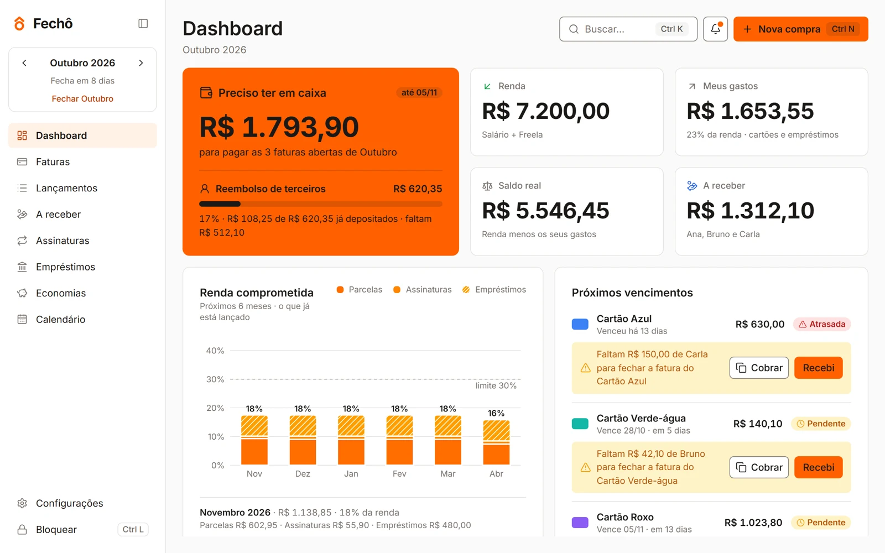
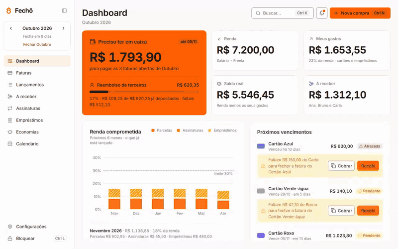
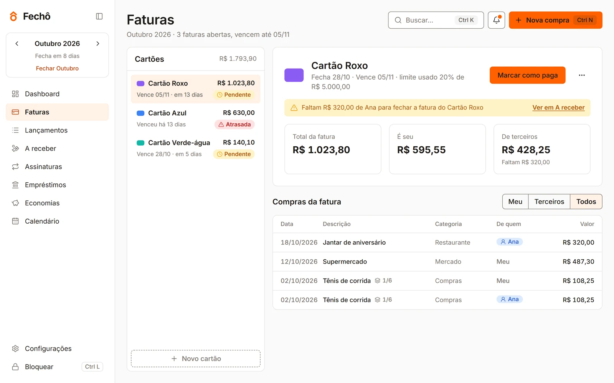
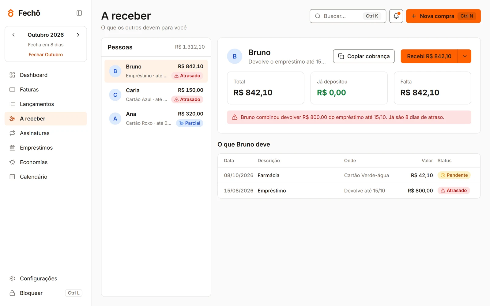
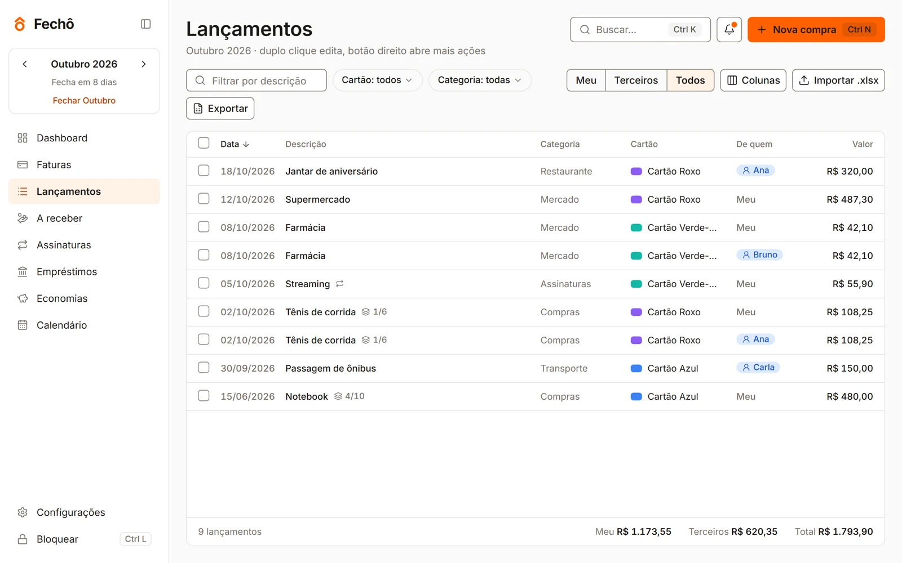

<picture>
  <source media="(prefers-color-scheme: dark)" srcset=".github/readme/hero-dark.svg">
  
</picture>

<p align="center">
  
  
  
  
</p>

Você paga a fatura inteira, mas metade dela é da sua irmã, de um amigo, da sua mãe. Eles depositam depois, às vezes em partes, às vezes com atraso, e a conta vive numa planilha que só você entende.

O Fechô guarda cada compra com o dono certo. Na abertura do mês ele responde três perguntas: quanto você precisa ter em caixa, quanto do gasto é seu e quem ainda não pagou a parte dele.

Tudo roda no seu computador. Não tem conta, login nem servidor: os dados ficam num banco SQLite na pasta do app.

<picture>
  <source media="(prefers-color-scheme: dark)" srcset=".github/readme/dashboard-dark.webp">
  
</picture>

## Uma compra em dez segundos

`Ctrl+N` abre a compra com o foco no valor. Você digita, escolhe de quem é e em quantas vezes, e a prévia mostra cada parcela na fatura certa, já com a parte de cada pessoa.

<picture>
  <source media="(prefers-color-scheme: dark)" srcset=".github/readme/nova-compra-dark.gif">
  
</picture>

## O que o Fechô faz

**Cartões e faturas.** O app calcula a fatura pelo dia de fechamento de cada cartão: compra feita no dia do fechamento cai na fatura seguinte. Parcelas somam o total ao centavo, e o centavo que sobra da divisão vai para a primeira.

**Quem te deve.** Você divide uma compra por percentual entre você e outras pessoas. Quando alguém deposita, você escolhe quais compras o depósito quita, e o valor pode ser parcial. O botão Cobrar copia uma mensagem pronta para o WhatsApp com valor, cartão, vencimento e sua chave Pix. Cinco dias antes do vencimento, o sino avisa quem ainda não pagou.

**O mês inteiro.** Assinaturas viram compra sozinhas no dia da cobrança. Um gráfico mostra quanto da renda dos próximos seis meses já está comprometida. Também entram empréstimos que você pegou ou fez, metas de economia com objetivos e um calendário com fechamentos e vencimentos.

**Fechar o mês.** Um passo a passo confere cada fatura com o extrato do banco (`.csv` ou `.xlsx`), registra o pagamento, cobra quem falta e trava o mês contra edições acidentais.

**Seus dados.** Backup automático guarda as dez últimas cópias, com criptografia opcional por senha (AES-GCM). Um PIN trava a tela. Você importa a planilha antiga com prévia de cada linha e exporta qualquer mês de volta para `.xlsx`.

<table>
  <tr>
    <td width="50%">
      <picture>
        <source media="(prefers-color-scheme: dark)" srcset=".github/readme/faturas-dark.webp">
        
      </picture>
      <p align="center"><sub>Faturas separadas por dono</sub></p>
    </td>
    <td width="50%">
      <picture>
        <source media="(prefers-color-scheme: dark)" srcset=".github/readme/receber-dark.webp">
        
      </picture>
      <p align="center"><sub>Quem deve, quanto e desde quando</sub></p>
    </td>
  </tr>
  <tr>
    <td colspan="2">
      <picture>
        <source media="(prefers-color-scheme: dark)" srcset=".github/readme/lancamentos-dark.webp">
        
      </picture>
      <p align="center"><sub>Lançamentos do mês, com busca, filtros e edição</sub></p>
    </td>
  </tr>
</table>

## Pelo teclado

| Atalho | Ação |
|---|---|
| `Ctrl+N` | Nova compra |
| `Ctrl+K` | Buscar e executar comandos |
| `Ctrl+R` | Registrar depósito |
| `Ctrl+←` `Ctrl+→` | Mês anterior e seguinte |
| `Ctrl+Z` | Desfazer a última ação |
| `Ctrl+L` | Travar com o PIN |
| `?` | Todos os atalhos |

## Por dentro

| Camada | Escolha |
|---|---|
| Desktop | Tauri 2 (Rust) com WebView2 |
| Interface | React 19, TypeScript strict, Vite, shadcn/ui, Tailwind |
| Animação | GSAP com Flip, respeitando "reduzir movimento" |
| Estado e formulários | Zustand, React Hook Form, Zod |
| Banco | SQLite com migrations versionadas; gravações com várias tabelas passam por comandos Rust em transação |
| Planilhas | SheetJS |
| Testes | Vitest, Testing Library, Playwright e `cargo test` |

Algumas regras valem para o código inteiro:

- Dinheiro anda em centavos inteiros. A formatação em reais acontece só na tela.
- Competência é sempre `YYYY-MM`, e datas sem hora ficam locais, sem conversão para UTC.
- `src/domain` guarda as regras de negócio em TypeScript puro, sem React e sem acesso a dados. A cobertura mínima ali é 90%.
- As telas conversam só com interfaces de repositório. No navegador o app usa uma implementação em memória com dados fictícios; no Tauri, o SQLite.
- Excluir marca `deleted_at`, e por isso toda exclusão oferece Desfazer.

```
src/
  app/          rotas, layout, store e atalhos
  domain/       regras de negócio com testes
  data/         contratos, SQLite, memória e migrations
  features/     uma pasta por tela
  components/   componentes de interface
src-tauri/      comandos Rust: transações, backup, criptografia
tests/e2e/      Playwright
```

## Instalar

Baixe o `.exe` ou o `.msi` da [última versão](https://github.com/tech-gabriel/fecho/releases/latest) e instale. O Windows pode mostrar o aviso do SmartScreen porque o instalador ainda não tem assinatura digital: clique em **Mais informações** e depois em **Executar assim mesmo**.

## Rodando

Precisa de Node 24, pnpm e Rust estável.

```sh
pnpm install
pnpm dev            # no navegador, com dados fictícios
pnpm tauri dev      # o app de verdade, com SQLite
pnpm verify         # lint, tipos e testes com cobertura
pnpm test:e2e       # Playwright
pnpm tauri build    # instaladores .exe e .msi
```

## Como o código anda

`develop` recebe as features por pull request com squash. As promoções seguem para `staging` e depois `main` com merge commit, e só uma tag `vX.Y.Z` na `main` gera os instaladores. Os commits seguem Conventional Commits em português, e os hooks rodam lint, tipos e testes antes de cada commit e push. O CI repete tudo e falha se a cobertura cair abaixo de 70% no projeto ou de 90% no domínio.

## Licença

O código está sob a [PolyForm Noncommercial 1.0.0](LICENSE). Você pode ler, estudar, modificar e usar o Fechô para fins pessoais e não comerciais. Uso comercial precisa de autorização: fale com [Gabriel de Paula](https://www.linkedin.com/in/tech-gabriel/).
